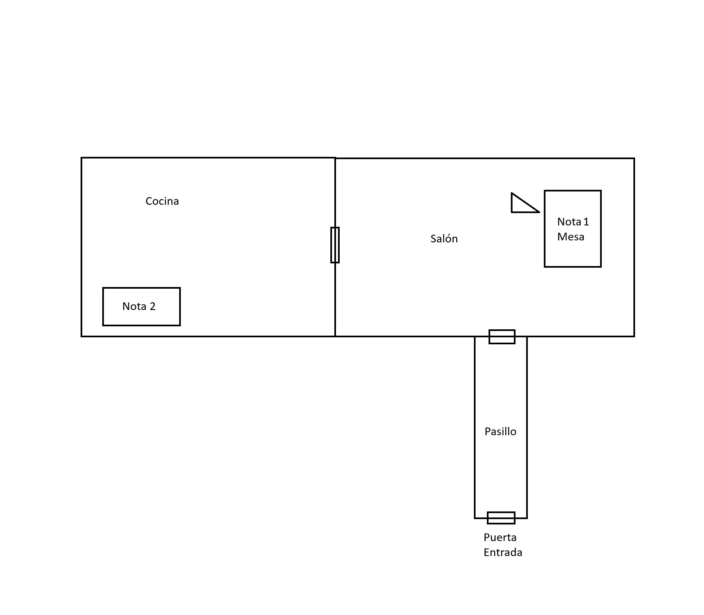

# Mini preproducción: «La última visita a casa»

> **Versión 1.0, escrita antes de implementar.** Si algo cambia durante el desarrollo, se añade una sección «Actualizaciones» al final, las decisiones originales no se borran (el historial de Git permite compararlas).

- **Autor:** Manuel Merino Martínez
- **Fecha de esta versión:** [28/10/2026] (commit: `docs: preproducción inicial`)
- **Motor:** Unity LTS 6000.0.85f1, C#, Windows, teclado y ratón
- **Presupuesto:** 5 jornadas (~40 h). Plazo: 5 de noviembre de 2026, incluido.

---

## 1. Resumen del diseño y objetivo

Experiencia de terror narrativo en primera persona de **2-5 minutos**. El jugador vuelve a la casa de su madre fallecida para recoger una caja de recuerdos. La puerta se cierra y la llave de salida está en una caja del salón que solo se abre recordando la rutina nocturna de su madre. Mientras busca, algo se mueve en la casa. Al abrir la puerta, oye desde dentro «No te vayas todavía».

**Objetivo:** entregar una experiencia **pequeña, completa y legible**, con código claro y ampliable, y con un proceso y documentación trazables.

**Lo común e inamovible:** protagonista, casa cotidiana, caja con llave, presencia inquietante, final, textos literales, recorrido y solución TAZA → RADIO → LÁMPARA.

**Lo que decido yo:** decoración, recursos visuales y sonoros, distribución concreta, estilo de UI, método de interacción con los botones.

## 2. Plano del recorrido

Tres zonas pequeñas. Desde el salón se accede a la cocina y al pasillo. No hay más puertas utilizables ni pistas falsas.

## 3. Flujo de 2-5 minutos

| Tiempo | Fase | Qué ocurre | Evento / estado |
|---|---|---|---|
| 0:00-0:25 | **Llegada** | Aparece mirando al salón. La puerta se cierra con sonido. Texto: «He venido a recoger la caja de mamá. Después entregaré las llaves». | `DoorClosed` |
| | | Si intenta abrir la salida: «La llave de repuesto está en su caja». | Salida bloqueada |
| 0:25-1:00 | **La caja** | Examina la caja: 3 botones + «Mamá guardaba aquí la llave de repuesto». Lee la nota 1 (orden de la rutina: cocina → escuchaba → luz). | `NoteRead(salon)` |
| 1:00-2:00 | **La pista** | Lee la nota de la cocina (té, radio, lámpara del pasillo). **Al cerrarla por primera vez**: 2 s de silencio, 3 pasos en el pasillo, la silla cambia de posición (fuera de la vista). | `KitchenNoteClosedFirstTime` → `TensionEvent` (una vez) |
| 2:00-4:00 | **Regreso y solución** | Vuelve al salón, ve la silla desplazada. Relee notas si quiere. Pulsa TAZA → RADIO → LÁMPARA. La caja se abre y recoge la llave explícitamente: «Llave de la entrada recogida». | `BoxOpened`, `KeyCollected` |
| 4:00-5:00 | **Salida y final** | Con llave, interactúa con la puerta: se abre, pasan unos instantes, se oye «No te vayas todavía», se cierra, fundido a negro, «Fin», Reiniciar / Salir. | `EndingStarted` (una vez) |

## 4. Desglose del puzzle y la rutina familiar

- **Solución:** `TAZA → RADIO → LÁMPARA`. Sin números, sin códigos aleatorios, sin inventario combinable.
- **Cadena de deducción:** nota del salón («primero lo que preparaba en la cocina, después lo que escuchaba, por último la luz que dejaba encendida») → pista en la cocina («taza de té», «noticias en la radio del salón», «lámpara del pasillo») → botones con iconos de taza, radio y lámpara.
- **Mecánica:**
  1. Cada pulsación añade un símbolo a la secuencia (máx. 3), muestra los elegidos y reproduce un clic.
  2. Al introducir el tercero se valida. Correcto: abre la caja **una sola vez**. Incorrecto: sonido suave, «No era así su rutina», limpia la secuencia.
  3. Reintentos ilimitados y botón para borrar el intento actual.
  4. Al resolver: botones desactivados, llave visible, al recogerla se oculta, se registra la posesión y aparece el mensaje. La caja no entrega otra llave.
- **Implementación:** componente `SequencePuzzle` genérico (solución configurable en el Inspector) + `PuzzleButton` por símbolo y añadir simbolos adicionales para que no sea descifrable con la primera nota. Reutilizable para un segundo puzzle.

## 5. Sistemas, recursos y decisiones técnicas

### Sistemas

| Sistema | Responsabilidad |
|---|---|
| `PlayerMovement` + `Camera` | Movimiento y cámara. Se puede bloquear. |
| `Interactor` | Raycast desde la cámara, prompt «E», invoca la interacción. |
| `InteractableBase` (abstracta) / `IInteractable` | Padre común para objetos interactuables(puerta,puzzle,notas): texto del prompt, `CanInteract`, `Interact`. |
| `NoteInteractable` (ScriptableObject) | Examinar pista: abre el panel de nota. |
| `PuzzleButton` (hereda de base) | Accionar mecanismo: envía un símbolo. |
| `SequencePuzzle` | Valida secuencia, emite `OnSolved` / `OnFailed`. |
| `BoxController` | Abrir tapa, mostrar llave, desactivar botones. |,
| `KeyPickup` (hereda de base) | Recoger llave. |
| `ExitDoor` (hereda de base) | Bloqueada / mensaje / inicia final con llave. |
| `GameProgress` | Estado y eventos del juego. |
| `TensionEvent` | Pasos + silla, una sola vez, se suscribe a `GameProgress`. |
| `EndingController` | Bloquea input, puerta, frase, fundido, «Fin», Reiniciar / Salir. |
| `UIManager` / `MessageUI` | Prompt, mensajes, panel de nota, símbolos elegidos. |
| `GameRestart` | Recarga la escena y restablece el estado. |

### Primeras decisiones técnicas

1. **Estado centralizado** en `GameProgress` con eventos.
2. **Herencia ligera** para la base de interacción (`InteractableBase`), composición para el resto. No se usan más patrones de los necesarios.
3. **ScriptableObject** solo para `NoteData` (texto/título de notas) y la solución del puzzle: contenido editable sin tocar código.
4. **Reinicio = recargar la escena.** Reiniciar toda la escena para uqe los eventos se puedan volver a hacer.
5. **Interacción directa en 3D** para notas, caja, llave y puerta, botones de la caja como objetos 3D pulsables.
6. **Notas en panel UI** que bloquean la vista, así la silla nunca cambia ante el jugador.

### Recursos previstos

- Modelado: **primitivas** para el greybox, mobiliario cotidiano de packs gratuitos como [VINTAGE LIVING ROOM 3D GAME PACK de ZNS3D en la Unity Store](https://assetstore.unity.com/packages/3d/environments/vintage-living-room-3d-game-pack-314464).
- Audio: puerta, clic, error suave, pasos, ambiente, frase final (grabada con voz propia). Fuentes: freesound.org (CC0/CC-BY), con atribución.
- Iconos: taza, radio, lámpara, mas los extras para los demás botones (dibujados o de un pack de emoticonos).
- Logo Bowl of Tentacles en pantalla de título/créditos.
- **Todo recurso externo y uso de IA se registra** en la memoria de ejecución en el dia usado con procedencia, licencia y uso.

## 6. Alcance, extras descartables y riesgos

### Alcance mínimo
Partida completa jugable de principio a fin con los textos literales, las 3 zonas, 2 notas, caja con puzzle, llave, evento de tensión, final y reinicio, build de Windows, README + mapa técnico + guía de ampliación, los tres documentos de proceso.

### Extras descartables (solo si sobra tiempo, en este orden)
1. Uso de modelos definidos para el escenario
2. Ambientación de iluminación (luz parpadeante, niebla ligera).
3. Tormenta para ambiente.
4. Variaciones de audio ambiente.

### Riesgos

1. Doble activación de eventos o del final
2. Reinicio deja eventos activados
3. Pistas poco legibles 
4. Partida fuera de 2-5 min 
5. Perder tiempo en arte/audio 
6. Proyecto no abre en otro ordenador

## 7. Estimación por bloques (≈ 40 h)

| # | Bloque | Estimación | Jornada |
|---|---|---|---|
| A | Preproducción, repo, tablero | 3 h | 1 |
| B | Greybox (3 zonas) + movimiento | 3 h | 1 |
| C | Interacción base + `GameProgress` + UI básica | 4 h | 1-2 |
| D | Notas, caja, puzzle, llave | 6 h | 2 |
| E | Documentar configuración del puzzle | 1 h | 2 |
| F | Eventos (pasos + silla) | 3 h | 3 |
| G | Puerta, final, fundido, reinicio | 4 h | 3 |
| H | Audio, iluminación y feedback | 4 h | 3-4 |
| I | Test con otra persona + correcciones | 4 h | 4 |
| J | Documentación (README, mapa técnico, guías) | 5 h | 2-5 |
| K | Build, prueba en limpio, memoria final | 3 h | 5 |
| | **Total** | **40 h** | |

## Actualizaciones
Aqui se añadiran posibles actualizaciones.

La caja se abrira presionando botones en la interfaz en vez de en el modelo 3d para que sea mas escalable y sencillo. 