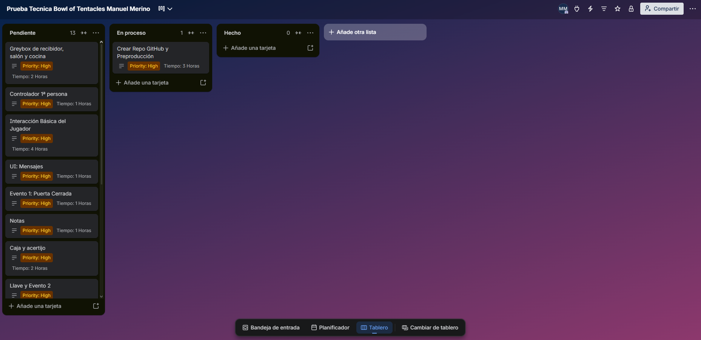

# Organización de tareas
Para la organización de tareas he elegido Trello para hacer el [tablero](https://trello.com/invite/b/6ae1dd0caff31092d54edb55/ATTIce1a63373af6db1acdd905157facf5bb805DD944/prueba-tecnica-bowl-of-tentacles-manuel-merino).

## Cómo elegí el orden de trabajo
1. Primero lo que desbloquea todo lo demás (repo, documento inicial, base de interacción).
2. Después una **partida completa con placeholders** (valor vertical) antes de pulir nada.
4. Pruebas con otra persona antes de cerrar documentación, para documentar la versión real.
5. Arte y audio pulido al final y recortable.

## Capturas

- Inicial:

- Final: 
 
 

