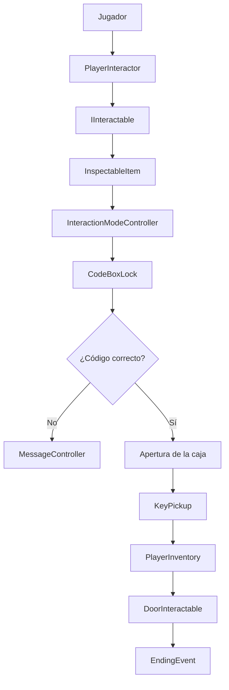

Mapa técnico

## 1. Introducción

Este documento describe la arquitectura técnica del proyecto, la organización de sus carpetas, los componentes principales y la comunicación entre los sistemas de interacción, puzzles y progresión narrativa.

El proyecto está desarrollado en Unity 6000.0.85f1 y utiliza C#.

La arquitectura se organiza en diferentes sistemas que permiten gestionar las interacciones del jugador con los objetos, la inspección, los puzzles, el inventario, las puertas y los eventos narrativos.

## 2. Estructura de carpetas

La carpeta `Assets` contiene los recursos y elementos principales del proyecto.

La estructura identificada es la siguiente:

```text
Assets/
├── 3DModel/
├── Animations/
├── BK_AlchemistHouse/
├── Images/
├── Prefabs/
├── Scenes/
├── Scripts/
│   ├── Interaction/
│   ├── CodeBoxLock.cs
│   ├── DoorIntroEvent.cs
│   ├── EndingEvent.cs
│   ├── MainMenuController.cs
│   ├── MessageController.cs
│   ├── NoteEvent.cs
│   ├── PlayerInventory.cs
│   └── PlayerMovement.cs
├── Settings/
├── Sounds/
├── Sprites/
└── TextMesh Pro/
```

### Descripción de las carpetas

| Carpeta | Contenido o finalidad |
|---|---|
| `3DModel` | Modelos 3D del proyecto. |
| `Animations` | Recursos de animación. |
| `Images` | Recursos de imagen. |
| `Prefabs` | Prefabs de Unity. |
| `Scenes` | Escenas del proyecto. |
| `Scripts` | Scripts C# del juego. |
| `Settings` | Configuración y recursos de Unity. |
| `Sounds` | Recursos de sonido. |
| `Sprites` | Sprites utilizados en el proyecto. |
| `TextMesh Pro` | Recursos relacionados con TextMesh Pro. |

La carpeta `Scripts/Interaction` agrupa los scripts relacionados con el sistema de interacción.

## 3. Componentes principales

### 3.1. Sistema de interacción

El sistema permite detectar objetos interactuables y ejecutar sus acciones.

Sus principales componentes son:

- `IInteractable`: interfaz común para los objetos que pueden recibir interacciones.
- `PlayerInteractor`: detecta los objetos interactuables delante del jugador y gestiona la entrada de interacción.
- `InspectableItem`: permite examinar objetos y gestionar sus características de inspección.
- `InteractionModeController`: controla el modo de inspección, la interfaz asociada y la salida de dicho modo.

### 3.2. Sistema de puzzles

El puzzle de la caja utiliza una combinación de símbolos que el jugador debe introducir correctamente.

Componentes principales:

- `CodeBoxLock`: almacena la combinación correcta, comprueba los símbolos introducidos y gestiona la apertura de la caja.
- `InteractionModeController`: conecta los botones de símbolos de la interfaz con el sistema de introducción del código.

Cuando la combinación es correcta, la caja se abre y permite acceder al objeto que contiene. Si es incorrecta, se muestra un mensaje y se reproduce un sonido de error.

### 3.3. Inventario y llaves

El inventario se gestiona mediante `PlayerInventory`.

Este componente almacena el estado de posesión de la llave de repuesto y permite añadirla o utilizarla.

`KeyPickup` gestiona la recogida de la llave por parte del jugador.

### 3.4. Sistema de puertas

`DoorInteractable` gestiona la interacción con las puertas, incluyendo sus estados de bloqueo, apertura y cierre.

La llave de repuesto permite desbloquear la puerta correspondiente.

### 3.5. Eventos narrativos

Los eventos narrativos se organizan mediante scripts independientes colocados en la escena.

Entre ellos se encuentran:

- `DoorIntroEvent`: gestiona el evento inicial relacionado con la puerta de entrada.
- `NoteEvent`: gestiona el acontecimiento asociado a la inspección de la nota de la cocina.
- `EndingEvent`: contiene la lógica relacionada con el evento final del juego.

### 3.6. Gestión de mensajes

`MessageController` centraliza la presentación de mensajes en pantalla, permitiendo mostrar información narrativa y mensajes relacionados con las interacciones.

### 3.7. Movimiento del jugador

`PlayerMovement` gestiona el movimiento del personaje.

El jugador utiliza WASD para desplazarse y el ratón para controlar la mirada.

## 4. Organización de objetos en la escena

La escena contiene objetos encargados de agrupar y gestionar diferentes sistemas.

Entre los objetos identificados se encuentran:

```text
GameScene
│
├── Interaction Manager
│   ├── InteractionModeController
│   └── MessageController
│
├── Events
│   ├── Scripts de eventos narrativos
│   └── Componentes de eventos
│
└── Player
    ├── PlayerMovement
    ├── PlayerInteractor
    └── PlayerInventory
```

## 5. Comunicación entre sistemas

La interacción y la progresión del juego se relacionan mediante diferentes componentes.

El recorrido principal de progresión es:

1. El jugador utiliza `PlayerInteractor` para detectar objetos interactuables.
2. Al interactuar con la caja, `InspectableItem` y `InteractionModeController` gestionan su inspección.
3. `CodeBoxLock` comprueba la combinación introducida mediante la interfaz.
4. Si la combinación es correcta, la caja se abre y permite recoger la llave.
5. `KeyPickup` registra la llave en `PlayerInventory`.
6. `DoorInteractable` consulta el inventario para comprobar si el jugador dispone de la llave.
7. Una vez cumplidas las condiciones necesarias, se puede continuar hacia el evento final.

### Diagrama de comunicación



Los eventos narrativos también se ejecutan mediante sus propios componentes dentro de la escena.

## 6. Gestión del estado

- `PlayerInventory` almacena si el jugador tiene la llave de repuesto.
- `CodeBoxLock` mantiene el estado de apertura de la caja.
- `DoorInteractable` gestiona el estado de bloqueo de las puertas.
- Los componentes de eventos controlan la ejecución de sus respectivas secuencias.

La lógica global de progresión se centraliza en el InteractionManager y Events, mientras que los componentes específicos mantienen los estados necesarios para sus responsabilidades.

## 7. Decisiones técnicas

Las principales decisiones de arquitectura son:

- **Interfaz común de interacción:** `IInteractable` permite que diferentes objetos compartan un mecanismo de interacción.
- **Separación de responsabilidades:** inspección, puzzles, inventario, puertas y eventos están distribuidos en componentes independientes.
- **Gestión centralizada de la interacción:** `InteractionModeController` controla los modos de inspección y su interfaz.
- **Eventos independientes:** los acontecimientos narrativos se implementan mediante scripts específicos.
- **Gestión del inventario:** el sistema actual utiliza `PlayerInventory` para almacenar la posesión de la llave.


